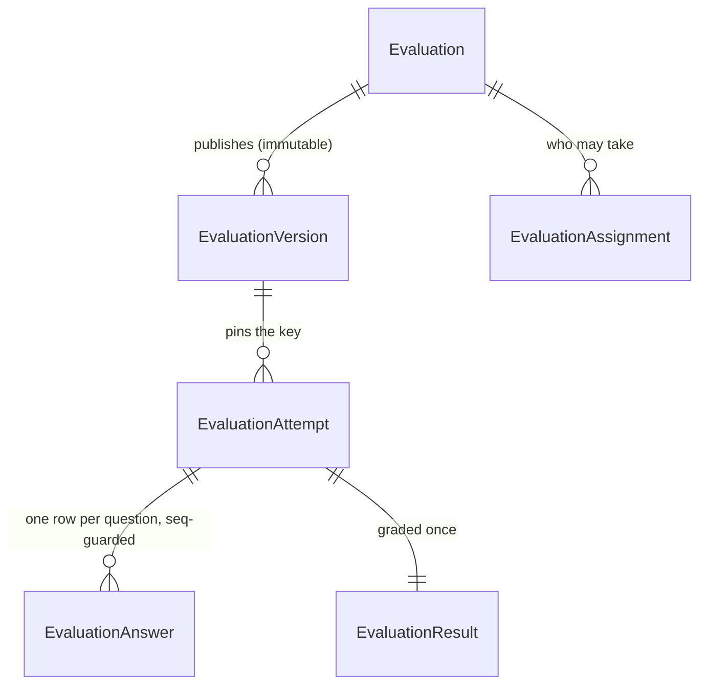

# 029 — Evaluations engine (Phase 4: backend and API)

Status: implemented and tested in CoreCrow (2026-11-17). Not deployed. No Exam Builder / Exam Player UI yet (Phase 5).

## Scope and rule
A generic module, `src/modules/evaluations`, enabled for **any** organization that holds the permissions. Nothing names an organization,
an exam, a question count or an option count. Synthetic fixtures live only in tests. The first real exam is created later through the API.

## Model (migration `20261117180000_evaluations`, additive and reversible; rollback SQL in its header)

- **Draft = one validated JSON document** on `Evaluation.draft` (sections, reference texts, questions, options, correct option, settings),
  edited with optimistic concurrency (`draftRevision`, optional `expectedRevision` on every write). Same idea as North panel revisions (ADR 014).
  Question-level API operations are pure functions over that document (`draft-ops.ts`).
- **Version = immutable snapshot incl. the answer key** (`EvaluationVersion`, database trigger rejects UPDATE/DELETE/TRUNCATE). Attempts pin a
  `versionId`; editing the draft or publishing v2 never changes an attempt in progress or a past result.
- Tenant integrity by composite foreign keys (version→evaluation, attempt→version, assignment→group/membership, result→attempt all carry `organizationId`).
- One open attempt per person and evaluation is a **partial unique index** (a double click or two tabs cannot open two).
- Points are integers in hundredths ("centi") everywhere; percent is derived.

## Content rules
Single-choice questions with 2–12 options (labels A, B, C… derived from position), optional shared reference text per question, sections, category
(competency) per question, per-question points, explanation. Blocks are plain text/list/image(North asset of the same organization)/table; nothing is interpreted as markup.
Draft saving is lenient; **publication is strict** (`validation.ts`): ≥1 question, ≥2 non-empty options, exactly one correct option that exists, points > 0,
known section/text, `AFTER_DATE` needs a date. Failure → `422 EVALUATION_INVALID`; `POST …/validate` lists every issue.
Settings (per version): duration, max attempts (null = unlimited), scoring (wrong/unanswered penalty %, floor at zero), review policy (NEVER / AFTER_SUBMIT / AFTER_DATE), AI-during-attempt flag.

## Grading and key protection
`grading.ts` is pure and deterministic and runs **on the server from the pinned version**; the client sends only choices. Results (correct / incorrect /
unanswered, score, max, percent, time used, per-category and per-section breakdown) are persisted once (`EvaluationResult.attemptId` is the key), so a repeated submit returns the same result.
The player payload (`playerContent`) carries neither `correctOptionId` nor explanations. Review (key + explanations) is returned only when the version's policy allows it for a
**closed** attempt, or to holders of `evaluations.results.read`. A person with only `evaluations.take` can reach no authoring, version, assignment or other person's result endpoint.
Deadlines are enforced lazily: any access after `deadlineAt` (+10 s network allowance, `CLOSE_GRACE_MS`) closes the attempt as `EXPIRED` and grades what was saved.

## Autosave and conflicts
`PUT …/answers` takes `{questionId, optionId|null, seq}`; the server ignores a write whose `seq` is not newer than the stored one and returns the authoritative state for the questions
sent (`applied`, `ignored`, `answers`). State lives in PostgreSQL, never only in the browser; any tab or device that loads the attempt sees the same answers.

## Permissions (added to `policy.ts`)
| Permission | Default roles | Grants |
| --- | --- | --- |
| `evaluations.read` | OWNER, ADMIN | list (no content/key), versions, assignments |
| `evaluations.create` / `.update` / `.delete` | OWNER, ADMIN | create, edit draft (**includes the key**), delete never-published drafts |
| `evaluations.publish` | OWNER, ADMIN | publish a version |
| `evaluations.manage` | OWNER, ADMIN | assignments, archive/unarchive |
| `evaluations.results.read` | OWNER, ADMIN | all attempts, any result with review |
| `evaluations.take` | OWNER, ADMIN, MEMBER, VIEWER | list *assigned* evaluations, attempt, autosave, submit, own result |
Taking additionally requires an assignment (role, group or person, optional window) — default deny; unassigned or unpublished looks like `404`.

## API (`/v1/organizations/:organizationId/…`, documented in `openapi.json`)
Authoring: `GET|POST /evaluations`, `GET|PATCH|DELETE /evaluations/:id`, `POST …/duplicate|archive|unarchive|validate|publish`, `GET …/versions`,
`POST …/sections|passages|questions`, `PATCH|DELETE …/sections/:id|passages/:id|questions/:id`, `PUT …/sections/order|questions/order`, `PUT …/questions/:id/correct-option`,
`GET|PUT …/assignments`, `GET …/attempts`. Taking: `GET /evaluations/available`, `POST /evaluations/:id/attempts`, `GET /evaluations/:id/my-attempts`,
`GET /evaluation-attempts/:attemptId`, `PUT …/answers`, `POST …/submit`, `GET …/result`.
Errors: `EVALUATION_INVALID`, `EVALUATION_REVISION_CONFLICT`, `EVALUATION_ORDER_INVALID`, `EVALUATION_CORRECT_OPTION_INVALID`, `EVALUATION_SECTION_NOT_EMPTY`, `EVALUATION_ARCHIVED`,
`EVALUATION_HAS_HISTORY`, `EVALUATION_ASSIGNMENT_INVALID|CONFLICT`, `EVALUATION_WINDOW_CLOSED`, `EVALUATION_ATTEMPTS_EXHAUSTED`, `ATTEMPT_CLOSED|OPEN|QUESTION_UNKNOWN|OPTION_UNKNOWN`.
All mutations are audited (`EVALUATION_*`, with the operation name, never the content). The organization always comes from the path and is checked against the principal's membership.

## Verification
`tests/evaluations.test.ts` (8 unit checks: schema, draft operations, publication rules, grading incl. penalties and breakdowns, player view without key, review policy) and
`tests/evaluations.integration.test.ts` (14 checks: full authoring→publication→assignment→attempt→autosave→grade flow, concurrency on start, stale-write handling, key change after
publication, review NEVER, attempts exhausted, results access, deadline expiry, cross-tenant isolation, trigger immutability, lifecycle, audit). The authorization matrix sweeps the new routes
(no session, foreign tenant, blocked network). Legacy `integration.test.ts` (23) still passes on a fresh database.

## Limitations / next
- No UI yet (Phase 5). Statistics (difficulty, distributions, historical comparison) are Phase 6; `GET …/attempts` is the raw material.
- Only single-choice questions. Shuffling, question bank reuse and AI drafting are not implemented.
- `available` reads each current snapshot to expose duration/attempt limits (fine for tens of evaluations; denormalize if it grows).
- Draft-level "preview as student" does not exist yet.
- Not deployed; the production migration needs the usual pre-run `pg_dump`.
